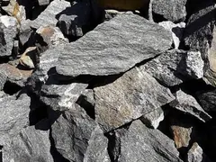
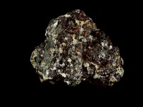
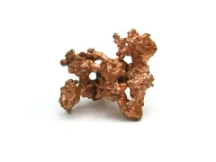
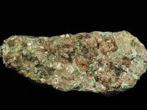
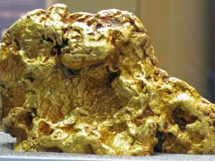
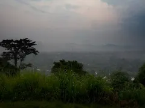
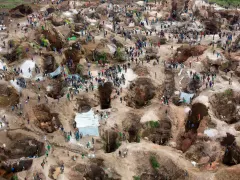
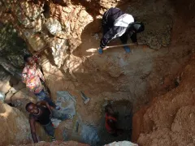
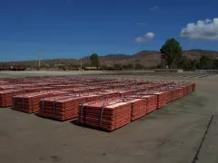

# Photo sources

All photographs on this site are **real photographs**, resized for faster
loading. None of them are AI-generated or AI-upscaled. Most come from
[Wikimedia Commons](https://commons.wikimedia.org/), where each linked row shows
the original file page, author, license and full-resolution file. The Coltan
photo is supplied by COOMIAC PROJET, so it has no external source link.

> The images are stored locally in `src/assets/` so the site never depends on a
> hotlink. Replacing a file with the same name changes the site immediately.
> All built-in images are imported through `src/assets/photos.ts`, which is used
> by `src/App.tsx`, `src/lib/models.ts` and the admin credits list.
> Small 240 × 180 previews used by the credits list live in `src/assets/thumbs/`
> and are regenerated automatically by `npm run photos:optimize`.

## Minerals

| Preview | File | Subject | Author | License | Source |
| --- | --- | --- | --- | --- | --- |
|  | `src/assets/minerals/coltan.webp` | Coltan ore | COOMIAC PROJET | Company photo | — |
|  | `src/assets/minerals/cassiterite.webp` | Cassiterite crystals with quartz | Shannon Heinle (GeoDIL) | [CC0 1.0](https://creativecommons.org/publicdomain/zero/1.0/) | [Wikimedia Commons](https://commons.wikimedia.org/wiki/File:Cassiterite_(GeoDIL_number_-_37).jpg) |
|  | `src/assets/minerals/copper.webp` | Native copper, macro | Jon Zander (Digon3) | [CC BY-SA 3.0](https://creativecommons.org/licenses/by-sa/3.0/) | [Wikimedia Commons](https://commons.wikimedia.org/wiki/File:Natural_Copper_Ore_Macro_1.JPG) |
|  | `src/assets/minerals/cobalt.webp` | Cobaltite ore | Darla Sondrol (GeoDIL) | [CC0 1.0](https://creativecommons.org/publicdomain/zero/1.0/) | [Wikimedia Commons](https://commons.wikimedia.org/wiki/File:Cobaltite_(GeoDIL_number_-_1151).jpg) |
|  | `src/assets/minerals/gold.webp` | Australian gold nugget, Field Museum | James St. John | [CC BY 2.0](https://creativecommons.org/licenses/by/2.0/) | [Wikimedia Commons](https://commons.wikimedia.org/wiki/File:Gold_nugget_(Australia)_4_(16848647509).jpg) |

## Site photography

| Preview | File | Subject | Author | License | Source |
| --- | --- | --- | --- | --- | --- |
|  | `src/assets/site/walikale.webp` | Walikale, North Kivu | MONUSCO / Sylvain Liechti | [CC BY-SA 2.0](https://creativecommons.org/licenses/by-sa/2.0/) | [Wikimedia Commons](https://commons.wikimedia.org/wiki/File:Walikale.jpg) |
|  | `src/assets/site/coltan-mine.webp` | Luwowo coltan mine near Rubaya | MONUSCO Photos | [CC BY-SA 2.0](https://creativecommons.org/licenses/by-sa/2.0/) | [Wikimedia Commons](https://commons.wikimedia.org/wiki/File:SRSG_visits_coltan_mine_in_Rubaya_(13406579753).jpg) |
|  | `src/assets/site/mining-2.webp` | Mining in Kailo, DR Congo | Julien Harneis | [CC BY-SA 2.0](https://creativecommons.org/licenses/by-sa/2.0/) | [Wikimedia Commons](https://commons.wikimedia.org/wiki/File:Mining_in_Kailo_2.jpg) |
|  | `src/assets/site/cathode.webp` | Bundles of cathode copper | ChrisFountain | [CC BY-SA 3.0](https://creativecommons.org/licenses/by-sa/3.0/) | [Wikimedia Commons](https://commons.wikimedia.org/wiki/File:Bundles_of_cathode_copper.png) |

The same list is available to visitors under **Gallery → Photo sources &
credits**, and to administrators under **Photo gallery → Built-in photos &
source links**.

## Replace a photo locally

### Option A — replace the file

Keep the exact file name and drop your own photo over it:

```
src/assets/minerals/coltan.webp
src/assets/minerals/cassiterite.webp
src/assets/minerals/copper.webp
src/assets/minerals/cobalt.webp
src/assets/minerals/gold.webp
src/assets/site/walikale.webp
src/assets/site/coltan-mine.webp
src/assets/site/mining-2.webp
src/assets/site/cathode.webp
```

Use a landscape photo (roughly 3:2 or 4:3, at least 1200 px wide). WebP is
preferred; JPG and PNG also work if you update the import in
`src/lib/models.ts` or `src/App.tsx`.

The product cards, hero and gallery use the full-size file. The credits list
uses a small preview from `src/assets/thumbs/<same-name>.webp`; replace that
too, or use Option B below, which updates both files automatically.

### Option B — let the script optimise it (recommended)

1. Drop a JPG, PNG or WebP into `photos-to-add/` using one of the names above.
2. Run `npm run photos:optimize`.
3. Reload the site.

The script resizes the image to at most 1600 px and converts it to WebP. See
[`photos-to-add/README.md`](photos-to-add/README.md) for the naming table.

### Option C — use the admin console

Sign in at `/admin/photo-gallery`, upload a photo and add EN/FR captions. Photos
uploaded to Firestore/Storage take priority over the built-in photos. This is
the right option for regularly changing lot photos, because it does not require
a code deploy.

When you add a new photo from another source, keep its author and license link
in this file (and replace the row above). CC BY and CC BY-SA photos require
attribution; CC0/public-domain photos do not, but the source link is still
useful.
